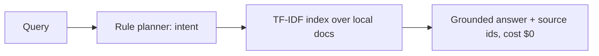

# On-Device Private Agent


**Private AI that runs entirely on the user's device — $0 inference, offline, no API key.**

**Target:** $0 inference at 1k users.
**Shows:** You ship private AI without API bills.

## Problem → Solution

Cloud LLM agents bill per token and send user data off-device. At 1,000 users
that is a real bill and a real privacy surface. This project proves the other
shape: index the user's own documents locally, plan with deterministic rules,
answer with citations to local sources — in Python (stdlib only) and in the
browser with a WebLLM stub + a vanilla-JS fallback that needs no download.

## Architecture



See [docs/ARCHITECTURE.md](docs/ARCHITECTURE.md), [docs/QUANTIZATION.md](docs/QUANTIZATION.md) (GGUF/Q4 size + latency table).

## Quickstart (<2 min)

```bash
git clone https://github.com/lionelsimai/on-device-private-agent && cd on-device-private-agent
pip install -e .
python -m on_device_private_agent.cli demo
python -m pytest -q   # 10 passed
```

Browser demo: open `browser/index.html` — no server, no download.

## Real demo output

```text
$ python -m on_device_private_agent.cli ask "What does inference cost?"
{
  "text": "Inference costs zero dollars because the model runs locally. ...",
  "intent": "question",
  "sources": ["pricing", "privacy"],
  "cost_usd": 0.0
}
```

## Benchmarks

```bash
python benchmarks/bench_retrieval.py
```
Measured in this build (sandbox CPU): 5/5 top-source accuracy, mean retrieval
latency 0.04 ms, total inference cost $0.00 — projected $0.00 for
1,000 users × 10 queries. Re-run the script to reproduce on your hardware.

## Limitations (honest)

- The Python core is retrieval + rules, not a generative LLM: answers are
  grounded extracts, not free-form generation. The browser WebLLM path is a
  documented integration stub (opt-in model download) with the JS fallback live.
- TF-IDF is lexical — synonyms without shared terms will miss. Embeddings are
  the roadmap fix, at the cost of a local model download.
- Privacy covers network/cloud exposure, not a compromised device OS.

## Roadmap

- [x] Offline TF-IDF core, rule planner, CLI, browser fallback, quantization + privacy docs
- [ ] WebLLM live wiring behind the stub; IndexedDB store + service-worker cache
- [ ] Optional local embedding index; GGUF/llama.cpp edge benchmark on a phone

## Contributing

See [CONTRIBUTING.md](CONTRIBUTING.md). Licence: MIT — see [LICENSE](LICENSE).
