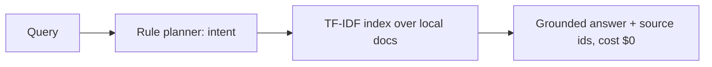

# On-Device Private Agent


**A local retrieval agent — no LLM, no API bill: it runs entirely on the user's device, offline, with no API key.**

The $0 inference figure is a *measurement of this design*, not an asserted
constant: the agent makes no API calls at all, so its measured per-query API
spend is $0.0000 and answering costs local CPU time only (see Benchmarks for
the method). There is no generative model in this build — answers are
grounded extracts from the user's own local documents.

**Target:** $0 measured inference spend at 1k users.
**Shows:** You ship private AI without API bills.

## Problem → Solution

Cloud LLM agents bill per token and send user data off-device. At 1,000 users
that is a real bill and a real privacy surface. This project proves the other
shape: index the user's own documents locally, plan with deterministic rules,
answer with citations to the local sources the answer actually uses — in
Python (stdlib only) and in the browser with a simplified vanilla-JS fallback
that needs no download. (A WebLLM integration hook exists in the browser code
but is a stub that returns null; no LLM runs in the demo today.)

## Architecture



See [docs/ARCHITECTURE.md](docs/ARCHITECTURE.md), [docs/QUANTIZATION.md](docs/QUANTIZATION.md) (GGUF/Q4 size + latency table).

## Quickstart (<2 min)

```bash
git clone https://github.com/lionelsimai/on-device-private-agent && cd on-device-private-agent
pip install -e .
python -m on_device_private_agent.cli demo
python -m pytest -q   # 12 passed
```

Browser demo: open `browser/index.html` — no server, no download.

## Real demo output

```text
$ python -m on_device_private_agent.cli ask "What does inference cost?"
{
  "text": "Inference costs zero dollars because everything runs locally and no API is called. Hosting a static page costs almost nothing, so 1000 users still cost $0 in inference. This agent runs entirely on device. No query leaves the device, no API key is required, and inference cost is zero. Documents are indexed locally with TF-IDF.",
  "intent": "question",
  "sources": [
    "pricing",
    "privacy"
  ],
  "cost_usd": 0.0
}
```
`sources` lists only the documents whose text the answer is built from
(regression-tested since 0.1.1 — retrieved-but-unused hits are not cited).

## Benchmarks

```bash
python benchmarks/bench_retrieval.py
```
Measured in this build (sandbox CPU, 24 hand-written queries, 0.1.1):

```text
Queries: 24  Top-source accuracy (expected in used sources): 24/24
Latency ms — mean 0.10, p95 0.07, max 1.71
Measured inference cost for 24 queries: $0.00
Projected cost for 1,000 users x 10 queries: $0.00 — method: measured per-query API spend ($0.0000, no API calls are made; answering is local compute) scaled linearly x417. Hosting/electricity are not inference spend and are excluded.
```

Before 0.1.1 the benchmark used 5 queries and a 4-of-5-samples "p95"; it now
uses 24 queries and a nearest-rank p95. Re-run the script to reproduce on
your hardware (the max is a first-query warmup outlier on this sandbox).

## Limitations (honest)

- The Python core is retrieval + rules, not a generative LLM: answers are
  grounded extracts, not free-form generation. The browser WebLLM hook is a
  stub that returns null unconditionally — the demo always runs the JS
  fallback, which is a simplified term-overlap version of the Python
  retrieval, not identical logic.
- TF-IDF is lexical — synonyms without shared terms will miss. Embeddings are
  the roadmap fix, at the cost of a local model download.
- Privacy covers network/cloud exposure, not a compromised device OS.

## Roadmap

- [x] Offline TF-IDF core, rule planner, CLI, browser fallback, quantization + privacy docs
- [ ] WebLLM live wiring behind the stub; IndexedDB store + service-worker cache
- [ ] Optional local embedding index; GGUF/llama.cpp edge benchmark on a phone

## Contributing

See [CONTRIBUTING.md](CONTRIBUTING.md). Licence: MIT — see [LICENSE](LICENSE).
