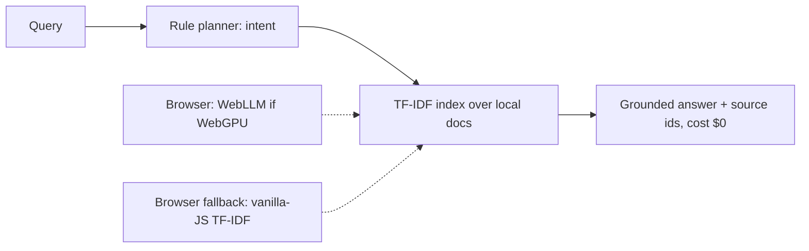

# Architecture

## Components
- **Planner** (`planner.py`): deterministic rules -> intent/action. No LLM, no cost, fully auditable.
- **Retrieval** (`retrieval.py`): TF-IDF over local documents, cosine similarity, stdlib only.
- **Core** (`core.py`): planner -> retrieval -> grounded answer with source ids and `cost_usd = 0.0`.
- **Browser** (`browser/app.js`): tries WebLLM (WebGPU) if present; otherwise runs the same TF-IDF logic in vanilla JS. Works from `file://` and offline.
- **Config** (`config.py`): environment-based settings (`PRIVATE_AGENT_*`), no hardcoded secrets.

## Privacy architecture
- Data stays on device: documents, index and queries never leave the machine.
- No API keys, no telemetry, no network calls in the Python core.
- Threat model: protects against cloud data exposure and per-token billing; it does not protect against a compromised device OS — use full-disk encryption.
- For a real LLM on device, load a Q4 GGUF / WebLLM model locally (see QUANTIZATION.md); weights are fetched once (or sideloaded) and inference stays local.

## Cost model
Static hosting only. Inference is local compute, so marginal cost per user = $0; 1,000 users = $0 inference.
